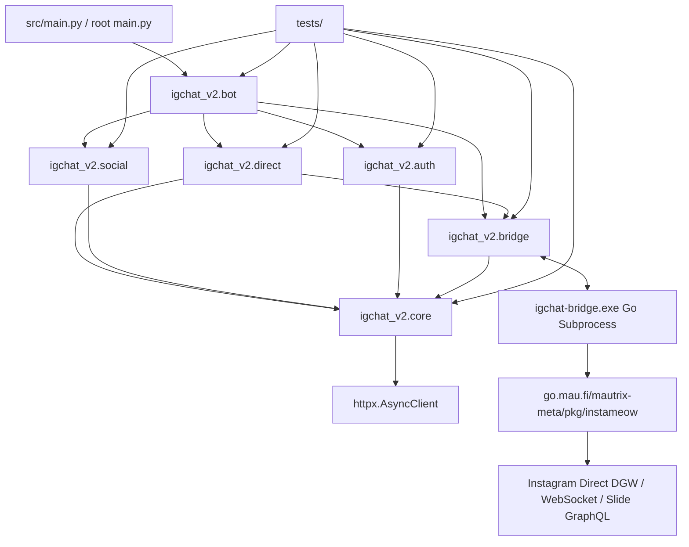
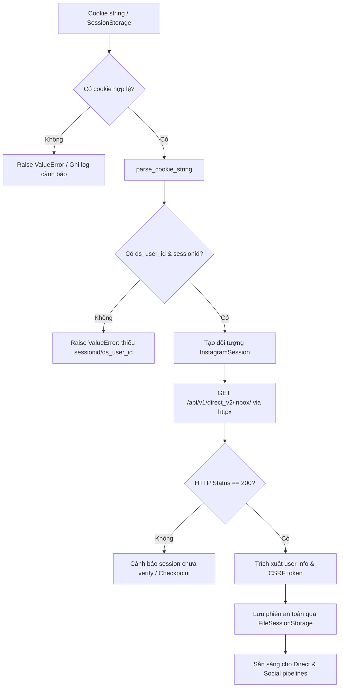
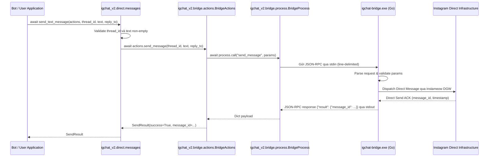
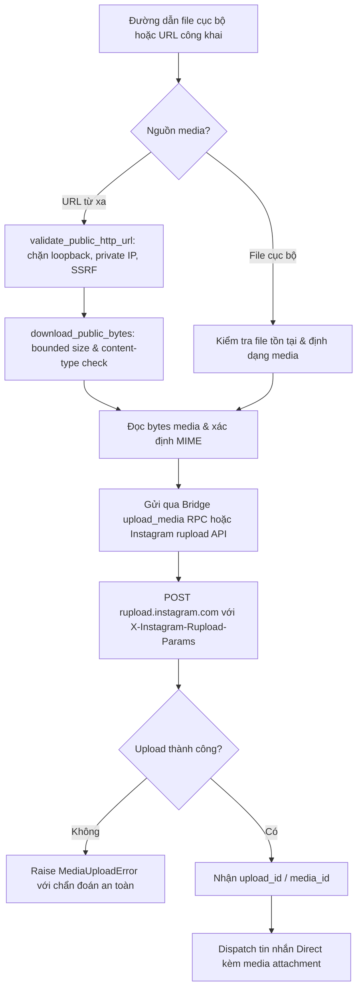
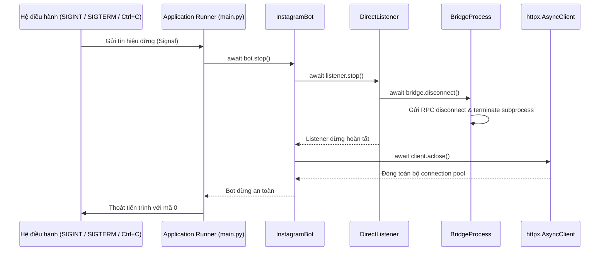

# igchat-v2 - Sơ đồ luồng xử lý v3.0.0

[README](README.md) | [README (EN)](README_EN.md) | [Tài liệu API](DOCS.md) | [Mindmap](mindmap-mermaid.md) | [Bridge Docs](bridge/README.md)

Các sơ đồ dưới đây mô tả chi tiết đường đi của dữ liệu và luồng thực thi trong kiến trúc `igchat-v2` v3.0.0. Toàn bộ tác vụ I/O được xây dựng trên `async`/`await` với connection pooling (`httpx.AsyncClient`) và tiến trình Go companion (`igchat-bridge.exe`) thông qua giao thức line-delimited JSON-RPC 2.0.

---

## 1. 🛤️ Luồng kiến trúc và quan hệ phụ thuộc



Phụ thuộc một chiều nghiêm ngặt: các module tính năng (`direct`, `social`, `bot`) phụ thuộc vào `core`, `auth` và `bridge`. Module `core` hoàn toàn độc lập và không bao giờ import ngược các tầng phía trên.

---

## 2. 💾 Khởi tạo phiên làm việc (Session Bootstrap)



`InstagramSession` được bảo vệ nghiêm ngặt: thông tin nhạy cảm (`sessionid`, token) luôn bị ẩn hoặc thay thế bằng `[REDACTED]` khi xuất ra log hoặc console.

---

## 3. 💬 Gửi tin nhắn Direct (Slide GraphQL / DGW)



Mọi hành động nhắn tin Direct (gửi, chỉnh sửa, thu hồi, thả reaction) đều đi qua pipeline JSON-RPC được kiểm soát chặt chẽ với timeout và generation fencing.

---

## 4. 📡 Luồng sự kiện thời gian thực (DirectListener Event Loop)

```mermaid
sequenceDiagram
    participant IG as Instagram Direct (Meta)
    participant Bridge as igchat-bridge.exe (Go)
    participant Reader as Stdin/Stdout Reader Thread
    participant Listener as igchat_v2.direct.listener.DirectListener
    participant Loop as asyncio Event Loop
    participant Bot as igchat_v2.bot.InstagramBot

    IG-->>Bridge: DGW WebSocket Push Event (New message, reaction, typing)
    Bridge->>Bridge: Sanitize payload & format JSON-RPC event
    Bridge-->>Reader: Line JSON string qua stdout
    Reader->>Reader: Parse JSON envelope
    Reader->>Loop: loop.call_soon_threadsafe(dispatch_event)
    Loop->>Listener: _handle_bridge_event(event)
    Listener->>Bot: on_message(MessageEvent)
    Bot->>Bot: Deduplicate qua Bounded LRU cache
    Bot->>Bot: Rate limit check (PerUserRateLimiter)
    Bot->>Bot: Match command & dispatch async handler
```

`DirectListener` nhận sự kiện thời gian thực từ Go bridge mà không tạo blocking thread trong Python event loop. Mọi message được chuẩn hóa thành `MessageEvent` strongly-typed.

---

## 5. 📎 Quy trình tải lên và gửi Media (SSRF Guard & rupload)



Bảo vệ SSRF toàn diện: không cho phép tải media từ `127.0.0.1`, `10.0.0.0/8`, `192.168.0.0/16`, `169.254.0.0/16` hoặc domain nội bộ.

---

## 6. 🌉 Cơ chế tự phục hồi và Reconnect Bridge

```mermaid
flowchart TD
    A[Mất kết nối WebSocket hoặc tiến trình Bridge thoát] --> B{Trạng thái dừng chủ động?}
    B -- Có --> C[Dọn dẹp tài nguyên và kết thúc]
    B -- Không --> D{Số lần thử lại <= max_retries?}
    D -- Không --> E[Kích hoạt BridgeFatalError và thông báo admin]
    D -- Có --> F[Tính thời gian chờ exponential backoff + jitter]
    F --> G[Tạm dừng (asyncio.sleep)]
    G --> H[Khởi động lại subprocess igchat-bridge.exe]
    H --> I[Gửi handshake connect kèm session cookies]
    I --> J{Kết nối thành công?}
    J -- Có --> K[Reset bộ đếm retry về 0 & tiếp tục lắng nghe]
    J -- Không --> L[Tăng số lần retry]
    L --> D
```

Bộ điều phối `ReconnectPolicy` tự động tính toán thời gian chờ lũy thừa kèm jitter ngẫu nhiên để tránh hiện tượng thundering herd khi máy chủ Instagram gặp sự cố mạng tạm thời.

---

## 7. 🤖 Bộ định tuyến lệnh Bot và Kiểm soát tốc độ

```mermaid
flowchart TD
    A[Nhận MessageEvent mới] --> B{Đã từng xử lý? (LRU Cache)}
    B -- Đã xử lý --> C[Bỏ qua - chống lặp lệnh]
    B -- Chưa xử lý --> D[Đánh dấu message_id vào LRU]
    D --> E{Tin nhắn từ chính Bot hoặc rỗng?}
    E -- Có --> F[Bỏ qua]
    E -- Không --> G{Nội dung bắt đầu bằng command prefix?}
    G -- Không --> H[Bỏ qua]
    G -- Có --> I[Tách tên lệnh và tham số]
    I --> J{Người dùng bị rate-limit? (PerUserRateLimiter)}
    J -- Bị hạn chế --> K[Gửi thông báo chờ hoặc bỏ qua]
    J -- Hợp lệ --> L{Lệnh yêu cầu quyền Admin?}
    L -- Có & Không phải Admin --> M[Từ chối thực thi: Unauthorized]
    L -- Không hoặc Là Admin --> N[Thực thi async command handler]
```

Bộ nhớ đệm LRU giới hạn dung lượng lưu trữ các message ID gần nhất để loại bỏ trùng lặp khi mạng chập chờn. Rate limiter theo từng người dùng ngăn chặn spam và bảo vệ tài khoản Instagram khỏi bị hạn chế tác vụ.

---

## 8. 🛑 Trình tự tắt ứng dụng an toàn (Graceful Shutdown)



Mọi kết nối mạng và tiến trình Go được dọn dẹp sạch sẽ, không để lại tiến trình mồ côi (zombie processes) hay rò rỉ socket khi người dùng dừng chương trình.
