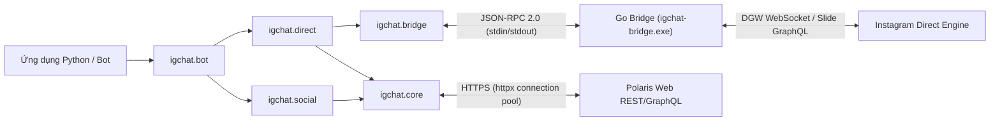

<div align="center">

<a href="https://github.com/0xshijn/igchat-v2">
  
</a>

<br />

<p>
  <a href="https://www.python.org/"></a>
  <a href="https://go.dev/"></a>
  <a href="LICENSE"></a>
  <a href="https://github.com/0xshijn"></a>
  <a href="https://t.me/ShiinNoHacker"></a>
</p>

<p>
  <a href="https://github.com/0xshijn/igchat-v2/stargazers"></a>
  <a href="https://github.com/0xshijn/igchat-v2/network/members"></a>
  <a href="https://github.com/0xshijn/igchat-v2/issues"></a>
  <a href="https://github.com/0xshijn/igchat-v2/actions/workflows/ci.yml"></a>
  
</p>

[🇬🇧 English](README_EN.md) · [💡 Ví dụ mẫu](examples/) · [🛡️ Bảo mật](SECURITY.md) · [🤝 Đóng góp](CONTRIBUTING.md) · [🌉 Go Bridge](bridge/README.md) · [🐛 Báo lỗi](https://github.com/0xshijn/igchat-v2/issues)

</div>

> *"Pwn the protocol, dissect the wire, automate the unscriptable."* — **0xshijn**

> [!WARNING]
> **IGChat-v2** là client không chính thức phục vụ mục đích nghiên cứu giao thức và tự động hóa Instagram Direct. Thư viện sử dụng cookie/phiên tài khoản cá nhân. Tuyệt đối không commit file chứa cookie (`config.json`) hoặc để lộ `sessionid` ra môi trường công cộng.

---

## 🎯 Giới thiệu tổng quan

**IGChat-v2 (v3.0.0)** được thiết kế và phát triển bởi **Phước Toàn (Shiin / [`0xshijn`](https://github.com/0xshijn))** như một giải pháp toàn diện, độc lập và chuẩn xác để tự động hóa **Instagram Direct** và các tính năng tương tác mạng xã hội Instagram.

**v3.0.0** mang đến nền tảng hiện đại, tối ưu và chuẩn xác dành riêng cho Instagram:
- ✅ **100% Pure Instagram**: Sử dụng chuẩn Instagram Direct DGW WebSocket, Slide GraphQL, và Polaris Web REST API.
- ✅ **Kiến trúc phân tầng chuyên nghiệp**: Python Async Client (`igchat`) kết hợp Go Bridge companion (`instameow`) giao tiếp qua JSON-RPC 2.0 dòng.

---

## ⚡ Điểm nổi bật & Tính năng kỹ thuật

<table>
  <tr>
    <td width="50%" valign="top">
      <h4>🚀 Async-First Python Client</h4>
      <p>Toàn bộ I/O xây dựng trên <code>asyncio</code> và <code>httpx.AsyncClient</code> với connection pooling tối ưu, timeout hữu hạn, và kiểm soát ngoại lệ chuẩn xác.</p>
    </td>
    <td width="50%" valign="top">
      <h4>🌉 Go Bridge thời gian thực (v3.0.0)</h4>
      <p>Tiến trình Go (<code>build/igchat-bridge.exe</code>) tích hợp <code>instameow</code> xử lý WebSocket DGW và MQTT bypass với cơ chế generation-fenced và tự động phục hồi.</p>
    </td>
  </tr>
  <tr>
    <td width="50%" valign="top">
      <h4>🛡️ Bảo vệ an toàn &amp; SSRF Guard</h4>
      <p>Kiểm tra URL nghiêm ngặt chặn tấn công SSRF vào mạng nội bộ/cloud metadata khi tải media; che giấu bí mật tự động trong log stderr; khóa quyền file lưu trữ (<code>0600</code> / Windows ACL).</p>
    </td>
    <td width="50%" valign="top">
      <h4>🤖 Khung Bot tích hợp sẵn</h4>
      <p>Lớp <code>InstagramBot</code> sẵn sàng vận hành với bộ đệm LRU chống lặp tin nhắn, rate-limiting độc lập theo từng user, router lệnh async và hỗ trợ quyền Admin an toàn.</p>
    </td>
  </tr>
</table>

---

## 🏗️ Kiến trúc hệ thống



| Package / Module | Đường dẫn | Vai trò |
|---|---|---|
| **`igchat.core`** | [`igchat/core/`](igchat/core/) | Data models (`InstagramSession`, `MessageEvent`), HTTP pooling, SSRF guard, bảo mật file, redaction |
| **`igchat.auth`** | [`igchat/auth/`](igchat/auth/) | Bootstrap session từ cookie, storage an toàn, Web AJAX login kèm 2FA TOTP (`pyotp`) |
| **`igchat.bridge`** | [`igchat/bridge/`](igchat/bridge/) | Quản lý tiến trình Go Bridge qua line JSON-RPC, generation-fencing, ReconnectPolicy exponential backoff |
| **`igchat.direct`** | [`igchat/direct/`](igchat/direct/) | Direct listener, gửi/sửa/thu hồi tin, reaction, quản lý inbox/nhóm, Notes 24h, rupload media |
| **`igchat.social`** | [`igchat/social/`](igchat/social/) | Profile, cập nhật bio, quan hệ bạn bè (follow/block), tương tác bài viết (like/save/comment), tìm kiếm |
| **`igchat.bot`** | [`igchat/bot/`](igchat/bot/) | Khung bot hoàn chỉnh, router lệnh, bộ lọc chống spam, rate limiter theo user, xử lý tín hiệu OS |
| **`bridge/`** | [`bridge/`](bridge/README.md) | Source code Go bridge dựa trên `instameow` biên dịch ra `build/igchat-bridge.exe` |

---

## 🛠️ Cài đặt & Chuẩn bị môi trường

### Yêu cầu hệ thống

- **Python 3.10+** (khuyên dùng Python 3.11 hoặc 3.12/3.13)
- **Go 1.23+** (dùng để biên dịch bridge Go)
- **Git** (để clone submodule `bridge/meta`)

### 1. Clone repository & cài đặt Python package

```bash
git clone --recurse-submodules https://github.com/0xshijn/igchat-v2.git
cd igchat-v2

# Khởi tạo môi trường ảo Python
python -m venv .venv

# Kích hoạt môi trường ảo:
# Windows (PowerShell):
.venv\Scripts\Activate.ps1
# Linux / macOS:
source .venv/bin/activate

# Nâng cấp pip và cài đặt phụ thuộc
python -m pip install --upgrade pip
python -m pip install -e .
```

### 2. Biên dịch Go Bridge companion

```bash
cd bridge
go test -v ./...
go build -trimpath -ldflags="-s -w -X main.bridgeVersion=3.0.0" -o ../build/igchat-bridge.exe .
cd ..
```

Kiểm tra binary bridge bằng script smoke test:

```bash
python scripts/smoke_bridge_rpc.py build/igchat-bridge.exe --expected-version 3.0.0
```

---

## 🚀 Hướng dẫn sử dụng nhanh

### 1. Gửi tin nhắn Direct cơ bản

```python
import asyncio
from igchat.auth import bootstrap_session
from igchat.direct import send_text_message


async def main() -> None:
    # 1. Khởi tạo session từ cookie Instagram
    cookie_str = "sessionid=YOUR_SESSION_ID; ds_user_id=YOUR_USER_ID; csrftoken=YOUR_CSRF_TOKEN;"
    session = await bootstrap_session(cookie_str)
    print(f"Logged in as: @{session.username} ({session.user_id})")

    # 2. Gửi tin nhắn Direct qua Polaris Web GraphQL
    result = await send_text_message(
        session,
        thread_id="340282366841710300949128134123456789012",
        text="Hello from igchat v3.0.0!",
    )
    print(f"Message sent! ID: {result.get('message_id')}")


if __name__ == "__main__":
    asyncio.run(main())
```

### 2. Lắng nghe tin nhắn theo thời gian thực (DirectListener)

```python
import asyncio
from typing import Any
from igchat.auth import bootstrap_session
from igchat.direct import DirectListener


async def handle_message(event: dict[str, Any]) -> None:
    data = event.get("data", {})
    thread_id = data.get("threadId") or data.get("thread_id")
    sender_id = data.get("senderId") or data.get("sender_id")
    text = data.get("text", "")
    print(f"[{thread_id}] @{sender_id}: {text}")


async def main() -> None:
    session = await bootstrap_session("sessionid=...; ds_user_id=...; csrftoken=...;")
    listener = DirectListener(session=session)
    listener.on_message(handle_message)

    print("Đang lắng nghe tin nhắn Instagram Direct...")
    await listener.start()


if __name__ == "__main__":
    asyncio.run(main())
```

---

## 🤖 Khởi chạy Bot Mẫu (`main.py`)

Dự án cung cấp sẵn khung bot hoàn chỉnh với đầy đủ các lệnh tiện ích và quản trị.

### 1. Cấu hình bot

Sao chép file cấu hình mẫu:

```bash
cp config.example.json config.json
```

Chỉnh sửa nội dung `config.json`:

```json
{
  "botName": "igchat-v2 bot",
  "prefix": "/",
  "cookies": "sessionid=...; ds_user_id=...; csrftoken=...;",
  "admins": ["1000xxxxxxxxxx"],
  "log_message_content": false,
  "debug_errors": false
}
```

### 2. Chạy bot

```bash
python main.py
```

<details>
<summary>📋 <b>Danh sách lệnh tích hợp sẵn trong bot (Bấm để xem chi tiết)</b></summary>

<br />

| Nhóm | Lệnh | Mô tả |
|---|---|---|
| **Hệ thống** | `/ping`, `/help`, `/info`, `/status`, `/uptime` | Kiểm tra trạng thái hoạt động, thời gian chạy, danh sách lệnh |
| **Tin nhắn** | `/echo`, `/react`, `/edit`, `/unsend`, `/quote` | Lặp lại nội dung, thả reaction, chỉnh sửa hoặc thu hồi tin nhắn |
| **Quản trị Nhóm** | `/rename`, `/add`, `/kick`, `/mute`, `/theme`, `/title` | Đổi tên nhóm chat, thêm/xóa thành viên, đổi chủ đề giao diện |
| **Instagram Notes**| `/note`, `/delnote`, `/notes`, `/music` | Đăng Note 24h, tìm kiếm nhạc và xóa Note cá nhân |
| **Mạng xã hội** | `/profile`, `/bio`, `/follow`, `/unfollow`, `/block` | Xem trang cá nhân, sửa bio, theo dõi, bỏ theo dõi và chặn người dùng |
| **Bài viết & Media**| `/like`, `/save`, `/comment`, `/delcomment` | Thả tim, lưu bài viết, gửi bình luận và xóa bình luận |

</details>

---

## 🧪 Kiểm thử chất lượng mã nguồn (Quality Gate)

Dự án đạt 100% tiêu chuẩn chất lượng nghiêm ngặt trước khi đóng gói:

```bash
# 1. Chạy toàn bộ test suite Python (38/38 tests passing)
pytest tests/ -v

# 2. Kiểm tra định dạng mã nguồn
black --check .
ruff check .

# 3. Kiểm tra kiểu dữ liệu tĩnh nghiêm ngặt
mypy igchat main.py scripts tests

# 4. Kiểm tra Go Bridge
cd bridge && go test -v ./... && go vet ./... && cd ..
```

---

## 📜 Giấy phép & Tác giả

Dự án được phân phối dưới giấy phép [**Apache License 2.0**](LICENSE).  
Thành phần Go bridge sử dụng `instameow` thuộc [mautrix-meta](https://github.com/mautrix/meta) theo giấy phép GPL-3.0.

<div align="center">

Phát triển & duy trì bởi **[Phước Toàn (Shiin / 0xshijn)](https://github.com/0xshijn)**
<br />
[Portfolio](https://0xshijn.is-a.dev) · [Telegram](https://t.me/ShiinNoHacker) · [Instagram](https://instagram.com/_phwctoazn) · [GitHub](https://github.com/0xshijn)

</div>
