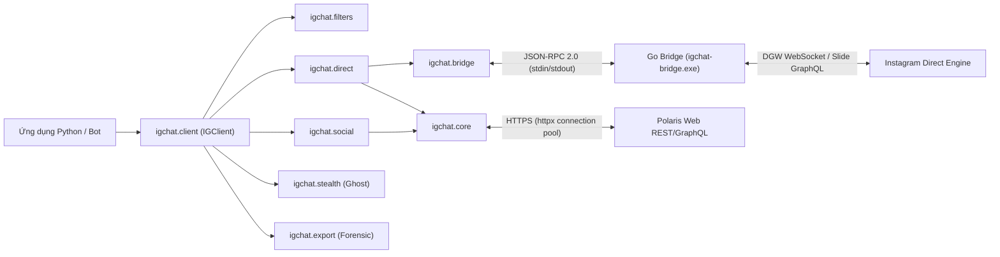

<div align="center">

<a href="https://github.com/0xshijn/igchat-v2">
  
</a>

<br />

<p>
  <a href="https://pypi.org/project/igchat-v2/"></a>
  <a href="https://pypi.org/project/igchat-v2/"></a>
  <a href="https://www.python.org/"></a>
  <a href="https://go.dev/"></a>
  <a href="LICENSE"></a>
</p>

<p>
  <a href="https://github.com/0xshijn/igchat-v2/stargazers"></a>
  <a href="https://github.com/0xshijn/igchat-v2/network/members"></a>
  <a href="https://github.com/0xshijn/igchat-v2/issues"></a>
  <a href="https://github.com/0xshijn/igchat-v2/actions/workflows/ci.yml"></a>
  
</p>

```bash
pip install igchat-v2
```

[🇬🇧 English](README_EN.md) · [📦 PyPI Package](https://pypi.org/project/igchat-v2/) · [💡 Ví dụ mẫu](examples/) · [🛡️ Bảo mật](SECURITY.md) · [🤝 Đóng góp](CONTRIBUTING.md) · [🌉 Go Bridge](bridge/README.md) · [🐛 Báo lỗi](https://github.com/0xshijn/igchat-v2/issues)

</div>

> *"Pwn the protocol, dissect the wire, automate the unscriptable."* — **0xshijn**

> [!WARNING]
> **IGChat-v2** là client không chính thức phục vụ mục đích nghiên cứu giao thức và tự động hóa Instagram Direct. Thư viện sử dụng cookie/phiên tài khoản cá nhân. Tuyệt đối không commit file chứa cookie (`config.json`) hoặc để lộ `sessionid` ra môi trường công cộng.

---

## 🎯 Giới thiệu tổng quan

**IGChat-v2 (v3.1.0)** được thiết kế và phát triển bởi **Phước Toàn (Shiin / [`0xshijn`](https://github.com/0xshijn))** như một giải pháp toàn diện, độc lập và chuẩn xác để tự động hóa **Instagram Direct** và các tính năng tương tác mạng xã hội Instagram.

**v3.1.0** mang đến nền tảng hiện đại, tối ưu và chuẩn xác dành riêng cho Instagram:
- ✅ **Cài đặt 1 dòng lệnh**: Đã chính thức có mặt trên PyPI (`pip install igchat-v2`).
- ✅ **100% Pure Instagram Protocol**: Sử dụng chuẩn Instagram Direct DGW WebSocket, Slide GraphQL, và Polaris Web REST API.
- ✅ **🥷 Zero-Presence Ghost Mode**: Đọc toàn bộ tin nhắn mà người gửi **tuyệt đối không bao giờ nhận được thông báo "Đã xem" (Seen)**.
- ✅ **🕵️ Headless Anti-Unsend & Forensic Archiver**: Tự động hứng và lưu tin nhắn/ảnh/voice trước khi bị đối phương thu hồi, xuất file HTML Dark Mode độc lập.
- ✅ **Kiến trúc phân tầng chuyên nghiệp**: Python Async Client (`igchat`) kết hợp Go Bridge companion (`instameow`) giao tiếp qua JSON-RPC 2.0 dòng.

---

## ⚡ Điểm nổi bật & Tính năng kỹ thuật

<table>
  <tr>
    <td width="50%" valign="top">
      <h4>🚀 Async-First Python Client</h4>
      <p>Toàn bộ I/O xây dựng trên <code>asyncio</code> và <code>httpx.AsyncClient</code> với connection pooling tối ưu, timeout hữu hạn, và kiểm soát ngoại lệ chuẩn xác.</p>
    </td>
    <td width="50%" valign="top">
      <h4>🌉 Go Bridge thời gian thực (v3.1.0)</h4>
      <p>Tiến trình Go (<code>build/igchat-bridge.exe</code>) tích hợp <code>instameow</code> xử lý WebSocket DGW và MQTT bypass với cơ chế generation-fenced và tự động phục hồi.</p>
    </td>
  </tr>
  <tr>
    <td width="50%" valign="top">
      <h4>🥷 Ghost Mode &amp; Humanizer</h4>
      <p>Tàng hình 100% không để lại dấu vết: triệt tiêu read receipts (không bao giờ hiện "Đã xem"), ẩn chỉ báo online <code>X-IG-Presence: 0</code>, và mô phỏng nhịp gõ phím phân phối chuẩn Gaussian.</p>
    </td>
    <td width="50%" valign="top">
      <h4>🕵️ Anti-Unsend &amp; Forensic Vault</h4>
      <p>Bộ nhớ đệm thời gian thực bắt trọn tin nhắn trước khi bị xoá. Hỗ trợ trích xuất ảnh "Xem 1 lần" từ CDN gốc và xuất báo cáo trò chuyện offline ra file HTML Dark Mode hoặc JSON.</p>
    </td>
  </tr>
  <tr>
    <td width="50%" valign="top">
      <h4>🛡️ Bảo vệ an toàn &amp; SSRF Guard</h4>
      <p>Kiểm tra URL nghiêm ngặt chặn tấn công SSRF vào mạng nội bộ/cloud metadata khi tải media; che giấu bí mật tự động trong log stderr; khóa quyền file lưu trữ (<code>0600</code> / Windows ACL).</p>
    </td>
    <td width="50%" valign="top">
      <h4>🤖 Khung Bot &amp; Composable Filters</h4>
      <p>Cú pháp decorator <code>@client.on(filters.command("...") &amp; filters.private)</code> linh hoạt với toán tử logic <code>&amp;</code>, <code>|</code>, <code>~</code>. Tích hợp sẵn bộ đệm chống trùng tin và per-user rate limiting.</p>
    </td>
  </tr>
</table>

---

## 🏗️ Kiến trúc hệ thống



| Package / Module | Đường dẫn | Vai trò |
|---|---|---|
| **`igchat.client`** | [`igchat/client.py`](igchat/client.py) | **High-Level Fluent SDK (`IGClient`)**: Context manager, event decorators `@client.on(...)`, auto pagination |
| **`igchat.filters`** | [`igchat/filters.py`](igchat/filters.py) | **Bộ lọc tin nhắn tổ hợp**: Hỗ trợ toán tử logic `&`, `\|`, `~`, `^` (text, command, regex, media, group, sender...) |
| **`igchat.stealth`** | [`igchat/stealth.py`](igchat/stealth.py) | **Ghost Mode & Humanizer**: Ẩn danh hoàn toàn (chặn presence / không hiện "Đã xem"), mô phỏng tốc độ gõ phím Gaussian |
| **`igchat.export`** | [`igchat/export.py`](igchat/export.py) | **Sao lưu hội thoại forensic**: Xuất dữ liệu Direct ra JSON, Markdown hoặc trang HTML Dark Mode giao diện chuẩn Instagram |
| **`igchat.core`** | [`igchat/core/`](igchat/core/) | Data models (`InstagramSession`, `MessageEvent`), HTTP pooling, SSRF guard, bảo mật file, redaction |
| **`igchat.auth`** | [`igchat/auth/`](igchat/auth/) | Bootstrap session, **Encrypted Vault (PBKDF2 + authenticated stream cipher)**, Web AJAX login kèm 2FA TOTP |
| **`igchat.bridge`** | [`igchat/bridge/`](igchat/bridge/) | Quản lý tiến trình Go Bridge qua line JSON-RPC, generation-fencing, ReconnectPolicy exponential backoff |
| **`igchat.direct`** | [`igchat/direct/`](igchat/direct/) | Direct listener, gửi/sửa/thu hồi tin, reaction, **Themes & Direct Polls**, **Voice waveform (64 peaks)** |
| **`igchat.social`** | [`igchat/social/`](igchat/social/) | Profile, bio, quan hệ bạn bè, **Phân tích Unfollowers & Close Friends (`analytics.py`)**, tương tác bài viết |
| **`igchat.bot`** | [`igchat/bot/`](igchat/bot/) | Khung bot hoàn chỉnh, router lệnh, bộ lọc chống spam, rate limiter theo user, xử lý tín hiệu OS |

---

## 🛠️ Cài đặt & Bắt đầu nhanh

### Cách 1: Cài đặt từ PyPI (Khuyên dùng)

```bash
pip install igchat-v2
```

### Cách 2: Cài đặt từ mã nguồn (Dành cho Developer)

```bash
git clone https://github.com/0xshijn/igchat-v2.git
cd igchat-v2

# Khởi tạo môi trường ảo Python
python -m venv .venv
.venv\Scripts\Activate.ps1 # Hoặc: source .venv/bin/activate

# Cài đặt chế độ editable
pip install -e ".[dev]"

# Chạy test suite
pytest tests/
```

---

## 🚀 Hướng dẫn sử dụng nhanh

### 1. Fluent SDK & Lắng nghe tin nhắn kèm Ghost Mode

```python
import asyncio
from igchat import IGClient, filters


async def main() -> None:
    # Khởi tạo client từ cookie với chế độ Ghost Mode (đọc tin nhắn KHÔNG gửi "Đã xem")
    async with await IGClient.from_cookie("sessionid=...; ds_user_id=...; csrftoken=...;", stealth=True) as client:

        # Lắng nghe lệnh /ping trong chat riêng
        @client.on(filters.command("ping") & filters.private)
        async def on_ping(event: dict) -> None:
            thread_id = event["data"]["threadId"]
            await client.send_message(thread_id, "pong! 🥷 (Tin nhắn này được đọc ẩn danh)")

        print("Bot đang chạy với chế độ Ghost Mode...")
        await client.run_forever()


if __name__ == "__main__":
    asyncio.run(main())
```

### 2. Gửi tin nhắn Direct cơ bản

```python
import asyncio
from igchat.auth import bootstrap_session
from igchat.direct import send_text_message


async def main() -> None:
    session = await bootstrap_session("sessionid=...; ds_user_id=...; csrftoken=...;")
    
    # Gửi tin nhắn qua Polaris GraphQL chuẩn
    result = await send_text_message(
        session,
        thread_id="17845618319961946",
        text="Xin chào từ igchat-v2 v3.1.0!",
    )
    print("Trạng thái:", result.get("status"))


if __name__ == "__main__":
    asyncio.run(main())
```

### 3. Xuất toàn bộ cuộc trò chuyện ra HTML Dark Mode

```python
import asyncio
from igchat.auth import bootstrap_session
from igchat.export import export_thread_to_html


async def main() -> None:
    session = await bootstrap_session("sessionid=...; ds_user_id=...; csrftoken=...;")
    
    # Tải và xuất toàn bộ lịch sử trò chuyện ra file HTML tự chứa
    html_file = await export_thread_to_html(
        session,
        thread_id="17845618319961946",
        output_path="chat_export.html",
    )
    print(f"Đã xuất báo cáo trò chuyện: {html_file}")


if __name__ == "__main__":
    asyncio.run(main())
```

---

## 🧪 Kiểm thử chất lượng (Test Suite)

Dự án bao gồm **50/50 unit tests** toàn diện với tỷ lệ pass 100%:

```bash
pytest tests/
# ============================= 50 passed in 1.98s =============================
```

---

## 🤝 Đóng góp & Phát triển

Mọi đóng góp, báo lỗi và ý tưởng phát triển đều được hoan nghênh! Vui lòng đọc kỹ [`CONTRIBUTING.md`](CONTRIBUTING.md) và tuân thủ [`CODE_OF_CONDUCT.md`](CODE_OF_CONDUCT.md).

---

## 📜 Bản quyền & Giấy phép

Phát triển bởi **[Phước Toàn (Shiin / 0xshijn)](https://github.com/0xshijn)**.  
Dự án được phân phối dưới giấy phép **[Apache-2.0 License](LICENSE)**.
