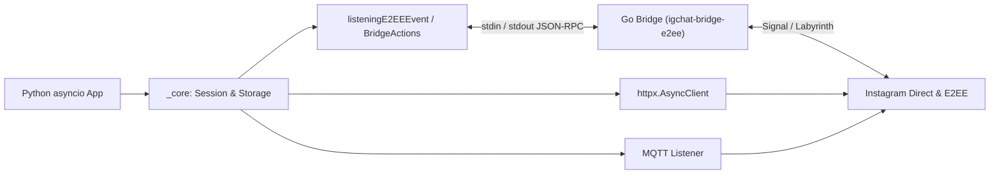

<div align="center">

<a href="https://github.com/0xshijn/igchat-v2">
  
</a>

<br />

<p>
  <a href="https://www.python.org/"></a>
  <a href="https://go.dev/"></a>
  <a href="LICENSE"></a>
  <a href="https://github.com/0xshijn"></a>
  <a href="https://t.me/ShiinNoHacker"></a>
</p>

[🇬🇧 English](README_EN.md) · [📖 Tài liệu API](DOCS.md) · [🔀 Flowchart](FLOWCHART.md) · [🔐 Bridge E2EE](bridge-e2ee/README.md) · [🐛 Báo lỗi](https://github.com/0xshijn/igchat-v2/issues)

</div>

> [!WARNING]
> **IGChat-v2** là client không chính thức tương tác với Instagram bằng cookie/phiên tài khoản cá nhân. Không đưa cookie thật hay `src/config.json` vào repository hoặc log công khai, và tự cân nhắc rủi ro tài khoản trước khi vận hành tự động hóa.

---

## Tổng quan

**IGChat-v2** được phát triển bởi **Phước Toàn (Shiin / [`0xshijn`](https://github.com/0xshijn))** nhằm cung cấp một nền tảng `asyncio` gọn, sạch và dễ mở rộng để tự động hóa **Instagram Direct**. Thay vì nhồi logic nặng vào một khối đồng bộ, thư viện tách rõ HTTP async (`httpx`), luồng sự kiện thời gian thực (`paho-mqtt`), và phần mã hóa đầu cuối E2EE (Labyrinth / Signal) sang một **Go JSON-RPC Bridge** chạy độc lập.

### Điểm nổi bật

<table>
  <tr>
    <td width="50%" valign="top">
      <h4>⚡ Kiến trúc Async-First</h4>
      <p>Toàn bộ session, HTTP transport và nghiệp vụ cốt lõi dùng <code>httpx.AsyncClient</code> hỗ trợ connection pooling, <code>asyncio.gather</code> và giao diện <code>igchat_v2</code> sạch sẽ.</p>
    </td>
    <td width="50%" valign="top">
      <h4>🔐 Giải mã E2EE tách biệt qua Go</h4>
      <p>Bridge Go (<code>igchat-bridge-e2ee</code> dựa trên <code>mautrix-meta</code>) chạy dưới dạng subprocess giao tiếp JSON lines qua <code>stdin/stdout</code> — lỗi bridge không kéo sập Python.</p>
    </td>
  </tr>
  <tr>
    <td width="50%" valign="top">
      <h4>🔄 Reconnect &amp; Bảo vệ Phiên</h4>
      <p><code>ReconnectPolicy</code> tự nối lại MQTT/E2EE có backoff, phân biệt rõ lỗi mạng với lỗi hết hạn cookie và hỗ trợ khóa quyền <code>0600</code> / Windows ACL cho file cấu hình.</p>
    </td>
    <td width="50%" valign="top">
      <h4>🤖 Bộ Bot Mẫu Đầy Đủ</h4>
      <p><a href="src/main.py"><code>SimpleBot</code></a> đi kèm gần 40 nhóm lệnh thực chiến: bóc/tải Post &amp; Reel, xem Story, chống thu hồi (<code>/antiunsend</code>), voice note, quản trị nhóm.</p>
    </td>
  </tr>
</table>

---

## Kiến trúc hệ thống



| Tầng | Vị trí | Vai trò |
|---|---|---|
| **Core** | [`src/igchat_v2/_core/`](src/igchat_v2/_core/README.md) | Session bootstrap (`dataGetHome`), HTTP transport, file/env storage, login &amp; 2FA |
| **Features** | [`src/igchat_v2/_features/`](src/igchat_v2/_features/README.md) | Tìm kiếm, hồ sơ người dùng, bài viết timeline, tương tác &amp; quản trị nhóm/thread |
| **Messaging** | [`src/igchat_v2/_messaging/`](src/igchat_v2/_messaging/README.md) | Gửi tin HTTP, upload media, reaction, sửa/thu hồi, Notes 24h, MQTT &amp; E2EE listener |
| **Bridge** | [`bridge-e2ee/`](bridge-e2ee/README.md) | Binary Go `igchat-bridge-e2ee` xử lý Labyrinth / Signal E2EE qua JSON-RPC |

---

## Cài đặt

### Yêu cầu môi trường

- **Python 3.10+** (`httpx`, `paho-mqtt`, `pyotp`, `requests`)
- **Go 1.26.10+** &amp; **Git** *(chỉ cần khi build E2EE Bridge hoặc chạy bot mẫu `src/main.py`)*

### 1. Clone source &amp; cài package Python

```bash
git clone --recurse-submodules https://github.com/0xshijn/igchat-v2.git
cd igchat-v2

python -m venv .venv
# Windows PowerShell
.venv\Scripts\Activate.ps1
# Linux / macOS
source .venv/bin/activate

python -m pip install --upgrade pip
python -m pip install -e .
```

Kiểm tra package đã import đúng chuẩn:

```bash
python scripts/verify_distribution.py
```

### 2. Build Go E2EE Bridge *(dành cho E2EE &amp; `src/main.py`)*

Nếu chỉ dùng API HTTP hoặc listener MQTT thường, bạn có thể bỏ qua bước này.

```bash
git submodule update --init --recursive bridge-e2ee/meta
cd bridge-e2ee
go mod download

# Windows
go build -ldflags="-s -w" -o ../build/igchat-bridge-e2ee.exe .

# Linux / macOS
go build -ldflags="-s -w" -o ../build/igchat-bridge-e2ee .
```

Kiểm tra nhanh binary vừa build:

```bash
cd ..
# Windows
python scripts/smoke_bridge_rpc.py .\build\igchat-bridge-e2ee.exe --expected-version 2.3.4
# Linux / macOS
python scripts/smoke_bridge_rpc.py ./build/igchat-bridge-e2ee --expected-version 2.3.4
```

> [!TIP]
> Nếu đặt binary ở đường dẫn tùy chọn, khai báo biến môi trường `IGCHAT_E2EE_BIN` trỏ tới file thực thi.

---

## Bắt đầu nhanh (Python Async API)

### Khởi tạo session, gửi tin &amp; dùng chung `httpx.AsyncClient`

```python
import asyncio
import httpx

from igchat_v2 import SendAPI, dataGetHome
from igchat_v2._features._instagram import _search


async def main() -> None:
    data_igs = await dataGetHome("sessionid=...; ds_user_id=...; csrftoken=...;")
    if data_igs is None:
        raise RuntimeError("Cookie không hợp lệ hoặc phiên đăng nhập đã hết hạn.")

    async with httpx.AsyncClient(timeout=30) as client:
        users, sent = await asyncio.gather(
            _search.func(data_igs, "shijn", client=client),
            SendAPI().send(
                data_igs,
                "Xin chào từ IGChat-v2",
                threadID="100012345678",
                client=client,
            ),
        )
        print("IGSID:", data_igs["IGSID"])
        print("Search:", users)
        print("Send result:", sent)


asyncio.run(main())
```

### Lắng nghe &amp; gửi tin E2EE theo thời gian thực

```python
import asyncio

from igchat_v2 import listeningE2EEEvent


async def run_e2ee(data_igs: dict) -> None:
    listener = listeningE2EEEvent(data_igs)
    loop = asyncio.get_running_loop()
    events: asyncio.Queue[dict] = asyncio.Queue(maxsize=1000)

    def on_bridge_event(event: dict) -> None:
        if events.full():
            events.get_nowait()
        events.put_nowait(event)

    listener.on_message(lambda ev: loop.call_soon_threadsafe(on_bridge_event, ev))
    task = asyncio.create_task(listener.connect_mqtt())

    try:
        ready = await asyncio.to_thread(
            listener.wait_until_connected,
            listener.startup_timeout,
            require_e2ee=True,
        )
        if not ready:
            raise TimeoutError("Không hoàn tất bắt tay E2EE.")

        while True:
            event = await events.get()
            if event.get("type") == "e2eeMessage":
                msg = event["data"]
                if msg.get("text") == "/ping":
                    await listener.send_e2ee_message(msg["chatJid"], "pong!")
    finally:
        listener.stop()
        await task
```

Các thao tác nâng cao như sửa tin, thu hồi, thả reaction, đánh dấu đã đọc, gửi media/voice E2EE nằm trong [`BridgeActions`](src/igchat_v2/_messaging/README.md).

---

## Chạy Bot Mẫu (`src/main.py`)

Sao chép template cấu hình và điền cookie tài khoản:

```bash
# Windows PowerShell: Copy-Item src\config.example.json src\config.json
cp src/config.example.json src/config.json
```

```json
{
  "botName": "igchat-v2 bot",
  "prefix": "/",
  "cookies": "sessionid=...; ds_user_id=...; csrftoken=...;",
  "admins": ["1000xxxxxxxxxx"],
  "log_message_content": false,
  "debug_errors": false
}
```

Khởi chạy bot:

```bash
python src/main.py
```

<details>
<summary>📋 Danh sách lệnh tích hợp sẵn trong <code>SimpleBot</code> (bấm để mở rộng)</summary>

<br />

| Nhóm | Lệnh | Chức năng |
|---|---|---|
| **Hệ thống &amp; Chat** | `/hi`, `/ping`, `/help`, `/id`, `/echo` | Kiểm tra trạng thái, độ trễ (ms), xem ID thread/sender |
| **Hồ sơ &amp; Tìm kiếm** | `/info`, `/profile`, `/story`, `/search`, `/inbox`, `/thread`, `/history` | Tra cứu user, bio, avatar HD, link Story 24h, lịch sử tin nhắn |
| **Media &amp; Bóc Link** | `/image`, `/voice`, `/media`, `/dl`, `/autodl` | Gửi ảnh/voice từ URL, lấy CDN link, tự động bóc link Post/Reel |
| **Tương tác &amp; Tin nhắn** | `/react`, `/edit`, `/pin`, `/unpin`, `/forward`, `/antiunsend` | Thả cảm xúc, sửa/ghim/chuyển tiếp tin, chống thu hồi &amp; soi chỉnh sửa |
| **Bài viết Instagram** | `/like`, `/unlike`, `/comment`, `/save`, `/unsave` | Tương tác trực tiếp lên bài viết hoặc Reel từ trong chat |
| **Quản trị Nhóm &amp; Admin** | `/creategroup`, `/add`, `/kick`, `/promote`, `/demote`, `/rename`, `/groupavatar`, `/tagall`, `/requests`, `/accept`, `/follow`, `/unfollow`, `/bio`, `/block`, `/unblock`, `/mute`, `/pinthread`, `/deletethread`, `/unsend`, `/leave` | Điều hành nhóm chat, duyệt message request và lệnh quyền Admin |

</details>

---

## Tài liệu &amp; Kiểm thử

### Tài liệu chuyên sâu

| Tài liệu | Nội dung |
|---|---|
| [`DOCS.md`](DOCS.md) | Tài liệu API chi tiết: HTTP pooling, 2FA, timeout, reconnect và xử lý lỗi |
| [`FLOWCHART.md`](FLOWCHART.md) | Sơ đồ luồng runtime từ session bootstrap tới MQTT, E2EE và shutdown |
| [`mindmap-mermaid.md`](mindmap-mermaid.md) | Bản đồ cấu trúc module toàn bộ repository |
| [`_core`](src/igchat_v2/_core/README.md) · [`_features`](src/igchat_v2/_features/README.md) · [`_messaging`](src/igchat_v2/_messaging/README.md) | Hướng dẫn API bên trong từng tầng |
| [`bridge-e2ee/README.md`](bridge-e2ee/README.md) | Chi tiết JSON-RPC contract, event và quy trình build bridge Go |

### Kiểm tra chất lượng

```bash
# Python tests & static checks
pytest tests/ -v --tb=short
ruff check src tests scripts
black --check src tests scripts
mypy

# Go E2EE Bridge tests
cd bridge-e2ee && go test ./... && go vet ./...
```

---

## Giấy phép &amp; Tác giả

Phân phối theo giấy phép [**Apache License 2.0**](LICENSE). Thành phần E2EE bridge sử dụng thư viện upstream theo điều khoản riêng — xem chi tiết tại [`bridge-e2ee/README.md`](bridge-e2ee/README.md).

<div align="center">

Phát triển &amp; duy trì bởi **[Phước Toàn (Shiin)](https://github.com/0xshijn)**
<br />
[Portfolio](https://0xshijn.is-a.dev) · [Telegram](https://t.me/ShiinNoHacker) · [Instagram](https://instagram.com/_phwctoazn)

</div>
