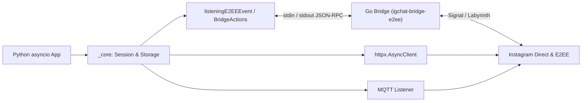

<div align="center">

<a href="https://github.com/0xshijn/igchat-v2">
  
</a>

<br />

<p>
  <a href="https://www.python.org/"></a>
  <a href="https://go.dev/"></a>
  <a href="LICENSE"></a>
  <a href="https://github.com/0xshijn"></a>
  <a href="https://t.me/ShiinNoHacker"></a>
</p>

[🇻🇳 Tiếng Việt](README.md) · [📖 API Docs](DOCS.md) · [🔀 Flowchart](FLOWCHART.md) · [🔐 E2EE Bridge](bridge-e2ee/README.md) · [🐛 Issues](https://github.com/0xshijn/igchat-v2/issues)

</div>

> [!WARNING]
> **IGChat-v2** is an unofficial client automating Instagram Direct using personal account cookies and session credentials. Never commit `src/config.json` or real cookies into source control or public logs, and evaluate account security risks before deploying automation.

---

## Overview

**IGChat-v2** is built and maintained by **Phước Toàn (Shiin / [`0xshijn`](https://github.com/0xshijn))** as a clean, extensible `asyncio`-native toolkit for **Instagram Direct**. Rather than bundling everything into blocking synchronous code, the architecture separates async HTTP transport (`httpx`), real-time MQTT event streaming (`paho-mqtt`), and end-to-end encryption (Labyrinth / Signal) through an isolated **Go JSON-RPC Bridge**.

### Highlights

<table>
  <tr>
    <td width="50%" valign="top">
      <h4>⚡ Async-First Core</h4>
      <p>Session bootstrap, HTTP transport, and account features run on <code>httpx.AsyncClient</code> with connection pooling, <code>asyncio.gather</code> concurrency, and a clean top-level <code>igchat_v2</code> package.</p>
    </td>
    <td width="50%" valign="top">
      <h4>🔐 Process-Isolated Go E2EE Bridge</h4>
      <p>The Go binary (<code>igchat-bridge-e2ee</code> powered by <code>mautrix-meta</code>) communicates via line-delimited JSON-RPC over <code>stdin/stdout</code> so bridge faults never crash the Python process.</p>
    </td>
  </tr>
  <tr>
    <td width="50%" valign="top">
      <h4>🔄 Reconnect &amp; Session Hardening</h4>
      <p><code>ReconnectPolicy</code> handles MQTT/E2EE retries with backoff, separates expired-cookie failures from transient network errors, and enforces strict file permissions (<code>0600</code> / Windows ACL).</p>
    </td>
    <td width="50%" valign="top">
      <h4>🤖 Battery-Included Sample Bot</h4>
      <p><a href="src/main.py"><code>SimpleBot</code></a> ships with nearly 40 practical command groups: Post &amp; Reel extraction, 24h Story viewer, real-time anti-unsend/edit tracking, voice notes, and group moderation.</p>
    </td>
  </tr>
</table>

---

## Architecture



| Layer | Path | Responsibility |
|---|---|---|
| **Core** | [`src/igchat_v2/_core/`](src/igchat_v2/_core/README_EN.md) | Session bootstrap (`dataGetHome`), HTTP transport, file/env storage, login &amp; 2FA |
| **Features** | [`src/igchat_v2/_features/`](src/igchat_v2/_features/README_EN.md) | User lookup, search, timeline reactions/posts, and group/thread administration |
| **Messaging** | [`src/igchat_v2/_messaging/`](src/igchat_v2/_messaging/README_EN.md) | HTTP messaging, media uploads, reactions, edit/unsend, 24h Notes, MQTT &amp; E2EE listeners |
| **Bridge** | [`bridge-e2ee/`](bridge-e2ee/README.md) | Go binary `igchat-bridge-e2ee` handling Labyrinth / Signal E2EE over JSON-RPC |

---

## Installation

### Prerequisites

- **Python 3.10+** (`httpx`, `paho-mqtt`, `pyotp`, `requests`)
- **Go 1.26.10+** &amp; **Git** *(only required for building the E2EE Bridge or running `src/main.py`)*

### 1. Clone &amp; install the Python package

```bash
git clone --recurse-submodules https://github.com/0xshijn/igchat-v2.git
cd igchat-v2

python -m venv .venv
# Windows PowerShell
.venv\Scripts\Activate.ps1
# Linux / macOS
source .venv/bin/activate

python -m pip install --upgrade pip
python -m pip install -e .
```

Verify the installed package layout:

```bash
python scripts/verify_distribution.py
```

### 2. Build the Go E2EE Bridge *(required for E2EE &amp; `src/main.py`)*

Skip this step if you only use standard HTTP endpoints or the regular MQTT listener.

```bash
git submodule update --init --recursive bridge-e2ee/meta
cd bridge-e2ee
go mod download

# Windows
go build -ldflags="-s -w" -o ../build/igchat-bridge-e2ee.exe .

# Linux / macOS
go build -ldflags="-s -w" -o ../build/igchat-bridge-e2ee .
```

Smoke-test the compiled binary:

```bash
cd ..
# Windows
python scripts/smoke_bridge_rpc.py .\build\igchat-bridge-e2ee.exe --expected-version 2.3.4
# Linux / macOS
python scripts/smoke_bridge_rpc.py ./build/igchat-bridge-e2ee --expected-version 2.3.4
```

> [!TIP]
> If the binary is placed outside `./build/`, point `IGCHAT_E2EE_BIN` to the executable path.

---

## Quick Start (Python Async API)

### Initialize a session, send a DM &amp; share `httpx.AsyncClient`

```python
import asyncio
import httpx

from igchat_v2 import SendAPI, dataGetHome
from igchat_v2._features._instagram import _search


async def main() -> None:
    data_igs = await dataGetHome("sessionid=...; ds_user_id=...; csrftoken=...;")
    if data_igs is None:
        raise RuntimeError("Invalid cookie or expired Instagram session.")

    async with httpx.AsyncClient(timeout=30) as client:
        users, sent = await asyncio.gather(
            _search.func(data_igs, "shijn", client=client),
            SendAPI().send(
                data_igs,
                "Hello from IGChat-v2",
                threadID="100012345678",
                client=client,
            ),
        )
        print("IGSID:", data_igs["IGSID"])
        print("Search:", users)
        print("Send result:", sent)


asyncio.run(main())
```

### Real-time E2EE listener &amp; reply

```python
import asyncio

from igchat_v2 import listeningE2EEEvent


async def run_e2ee(data_igs: dict) -> None:
    listener = listeningE2EEEvent(data_igs)
    loop = asyncio.get_running_loop()
    events: asyncio.Queue[dict] = asyncio.Queue(maxsize=1000)

    def on_bridge_event(event: dict) -> None:
        if events.full():
            events.get_nowait()
        events.put_nowait(event)

    listener.on_message(lambda ev: loop.call_soon_threadsafe(on_bridge_event, ev))
    task = asyncio.create_task(listener.connect_mqtt())

    try:
        ready = await asyncio.to_thread(
            listener.wait_until_connected,
            listener.startup_timeout,
            require_e2ee=True,
        )
        if not ready:
            raise TimeoutError("E2EE handshake timed out.")

        while True:
            event = await events.get()
            if event.get("type") == "e2eeMessage":
                msg = event["data"]
                if msg.get("text") == "/ping":
                    await listener.send_e2ee_message(msg["chatJid"], "pong!")
    finally:
        listener.stop()
        await task
```

For advanced actions (edit, unsend, reactions, mark-read, typing indicators, encrypted media/voice), use [`BridgeActions`](src/igchat_v2/_messaging/README_EN.md).

---

## Running the Sample Bot (`src/main.py`)

Create a local config from template and add your session cookies:

```bash
# Windows PowerShell: Copy-Item src\config.example.json src\config.json
cp src/config.example.json src/config.json
```

```json
{
  "botName": "igchat-v2 bot",
  "prefix": "/",
  "cookies": "sessionid=...; ds_user_id=...; csrftoken=...;",
  "admins": ["1000xxxxxxxxxx"],
  "log_message_content": false,
  "debug_errors": false
}
```

Start the bot:

```bash
python src/main.py
```

<details>
<summary>📋 Built-in <code>SimpleBot</code> commands (click to expand)</summary>

<br />

| Category | Commands | Description |
|---|---|---|
| **System &amp; Chat** | `/hi`, `/ping`, `/help`, `/id`, `/echo` | Health check, latency (ms), thread/sender IDs |
| **Profiles &amp; Search** | `/info`, `/profile`, `/story`, `/search`, `/inbox`, `/thread`, `/history` | User lookup, HD avatars, 24h Story direct links, chat history |
| **Media &amp; Downloader** | `/image`, `/voice`, `/media`, `/dl`, `/autodl` | Send media/voice from URLs, extract CDN URLs, auto-download Posts/Reels |
| **Reactions &amp; Tracking** | `/react`, `/edit`, `/pin`, `/unpin`, `/forward`, `/antiunsend` | React, edit, pin, forward messages, anti-unsend &amp; live edit monitor |
| **Instagram Actions** | `/like`, `/unlike`, `/comment`, `/save`, `/unsave` | Interact with Instagram Posts and Reels directly from chat |
| **Group &amp; Admin Control** | `/creategroup`, `/add`, `/kick`, `/promote`, `/demote`, `/rename`, `/groupavatar`, `/tagall`, `/requests`, `/accept`, `/follow`, `/unfollow`, `/bio`, `/block`, `/unblock`, `/mute`, `/pinthread`, `/deletethread`, `/unsend`, `/leave` | Full group administration, message request moderation, and admin controls |

</details>

---

## Documentation &amp; Verification

### Deep-Dive Docs

| Document | Coverage |
|---|---|
| [`DOCS.md`](DOCS.md) | Complete API reference: connection pooling, 2FA login, timeouts, reconnect, error contracts |
| [`FLOWCHART.md`](FLOWCHART.md) | Runtime flow across session bootstrap, HTTP, MQTT, E2EE, and shutdown |
| [`mindmap-mermaid.md`](mindmap-mermaid.md) | Full module map across the repository |
| [`_core`](src/igchat_v2/_core/README_EN.md) · [`_features`](src/igchat_v2/_features/README_EN.md) · [`_messaging`](src/igchat_v2/_messaging/README_EN.md) | Per-layer module documentation |
| [`bridge-e2ee/README.md`](bridge-e2ee/README.md) | JSON-RPC protocol specification, bridge events, and Go build guide |

### Development Checks

```bash
# Python tests & static checks
pytest tests/ -v --tb=short
ruff check src tests scripts
black --check src tests scripts
mypy

# Go E2EE Bridge tests
cd bridge-e2ee && go test ./... && go vet ./...
```

---

## License &amp; Author

Distributed under the [**Apache License 2.0**](LICENSE). Upstream components bundled inside the Go E2EE bridge carry their respective licenses — see [`bridge-e2ee/README.md`](bridge-e2ee/README.md).

<div align="center">

Built &amp; maintained by **[Phước Toàn (Shiin)](https://github.com/0xshijn)**
<br />
[Portfolio](https://0xshijn.is-a.dev) · [Telegram](https://t.me/ShiinNoHacker) · [Instagram](https://instagram.com/_phwctoazn)

</div>
