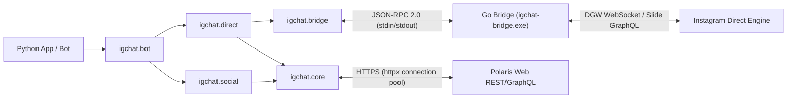

<div align="center">

<a href="https://github.com/0xshijn/igchat-v2">
  
</a>

<br />

<p>
  <a href="https://www.python.org/"></a>
  <a href="https://go.dev/"></a>
  <a href="LICENSE"></a>
  <a href="https://github.com/0xshijn"></a>
  <a href="https://t.me/ShiinNoHacker"></a>
</p>

<p>
  <a href="https://github.com/0xshijn/igchat-v2/stargazers"></a>
  <a href="https://github.com/0xshijn/igchat-v2/network/members"></a>
  <a href="https://github.com/0xshijn/igchat-v2/issues"></a>
  <a href="https://github.com/0xshijn/igchat-v2/actions/workflows/ci.yml"></a>
  
</p>

[🇻🇳 Tiếng Việt](README.md) · [💡 Examples](examples/) · [🛡️ Security](SECURITY.md) · [🤝 Contributing](CONTRIBUTING.md) · [🌉 Go Bridge](bridge/README.md) · [🐛 Bug Reports](https://github.com/0xshijn/igchat-v2/issues)

</div>

> *"Pwn the protocol, dissect the wire, automate the unscriptable."* — **0xshijn**

> [!WARNING]
> **IGChat-v2** is an unofficial client intended for protocol research and Instagram Direct automation. It authenticates using account session cookies. Never commit configuration files containing credentials (`config.json`) or expose your `sessionid` to public environments.

---

## 🎯 Overview

**IGChat-v2 (v3.0.0)** was designed and developed by **Phước Toàn (Shiin / [`0xshijn`](https://github.com/0xshijn))** as a comprehensive, independent, and accurate platform for automating **Instagram Direct** and Instagram social interactions.

**v3.0.0** delivers a modern, optimized, and native platform engineered specifically for Instagram:
- ✅ **100% Pure Instagram**: Native Instagram Direct DGW WebSocket, Slide GraphQL, and Polaris Web REST APIs.
- ✅ **Professional Layered Architecture**: Async Python client (`igchat`) paired with a Go bridge companion (`instameow`) communicating over line-delimited JSON-RPC 2.0.

---

## ⚡ Technical Highlights

<table>
  <tr>
    <td width="50%" valign="top">
      <h4>🚀 Async-First Python Client</h4>
      <p>Entire I/O built on top of <code>asyncio</code> and <code>httpx.AsyncClient</code> with pooled HTTP connections, finite timeouts, and structured error hierarchies.</p>
    </td>
    <td width="50%" valign="top">
      <h4>🌉 Real-time Go Bridge (v3.0.0)</h4>
      <p>High-performance Go daemon (<code>build/igchat-bridge.exe</code>) utilizing <code>instameow</code> to drive DGW WebSocket and MQTT bypass connections with generation fencing and auto-recovery.</p>
    </td>
  </tr>
  <tr>
    <td width="50%" valign="top">
      <h4>🛡️ Hardened Security &amp; SSRF Guard</h4>
      <p>Strict URL destination validation blocks SSRF attacks to internal networks / cloud metadata when downloading media; automatic secret redaction in stderr logs; atomic permission enforcement (<code>0600</code> / Windows ACL).</p>
    </td>
    <td width="50%" valign="top">
      <h4>🤖 Turnkey Bot Framework</h4>
      <p>Production-ready <code>InstagramBot</code> engine equipped with bounded LRU message deduplication, per-user rate limiting, async command router, and secure admin access controls.</p>
    </td>
  </tr>
</table>

---

## 🏗️ System Architecture



| Package / Module | Path | Description |
|---|---|---|
| **`igchat.client`** | [`igchat/client.py`](igchat/client.py) | **High-Level Fluent SDK (`IGClient`)**: Context manager, event decorators `@client.on(...)`, auto pagination |
| **`igchat.filters`** | [`igchat/filters.py`](igchat/filters.py) | **Composable Message Filters**: Bitwise operators `&`, `\|`, `~`, `^` (text, command, regex, media, group, sender...) |
| **`igchat.stealth`** | [`igchat/stealth.py`](igchat/stealth.py) | **Ghost Mode & Humanizer**: Stealth anti-detection, presence suppression (`X-IG-Presence: 0`), Gaussian typing pacing |
| **`igchat.export`** | [`igchat/export.py`](igchat/export.py) | **Forensic Chat Archiver**: Export threads to JSON, Markdown, or aesthetic Dark Mode HTML matching Instagram Web |
| **`igchat.core`** | [`igchat/core/`](igchat/core/) | Data models (`InstagramSession`, `MessageEvent`), HTTP pooling, SSRF guard, private file permissions, secret redaction |
| **`igchat.auth`** | [`igchat/auth/`](igchat/auth/) | Session bootstrap, **Encrypted Session Vault (PBKDF2 + authenticated stream cipher)**, Web AJAX login with 2FA TOTP |
| **`igchat.bridge`** | [`igchat/bridge/`](igchat/bridge/) | Subprocess supervisor for Go Bridge over line JSON-RPC, generation-fencing, ReconnectPolicy with backoff |
| **`igchat.direct`** | [`igchat/direct/`](igchat/direct/) | Direct listener, send/edit/unsend message, reactions, **Themes & Direct Polls**, **Voice waveform (64 peaks)** |
| **`igchat.social`** | [`igchat/social/`](igchat/social/) | Profile, bio editor, friendship actions, **Unfollowers & Close Friends Analytics (`analytics.py`)**, post interactions |
| **`igchat.bot`** | [`igchat/bot/`](igchat/bot/) | Comprehensive bot runtime, command router, spam filter, per-user rate limiter, OS signal handler |
| **`bridge/`** | [`bridge/`](bridge/README.md) | Go bridge source code powered by `instameow`, compiling to `build/igchat-bridge.exe` |

---

## 🛠️ Installation & Environment Setup

### Prerequisites

- **Python 3.10+** (Python 3.11, 3.12, or 3.13 recommended)
- **Go 1.23+** (for compiling the Go bridge)
- **Git** (with submodule support for `bridge/meta`)

### 1. Clone repository & install Python package

```bash
git clone https://github.com/0xshijn/igchat-v2.git
cd igchat-v2

# Create virtual environment
python -m venv .venv

# Activate virtual environment:
# Windows (PowerShell):
.venv\Scripts\Activate.ps1
# Linux / macOS:
source .venv/bin/activate

# Upgrade pip and install package in editable mode
python -m pip install --upgrade pip
python -m pip install -e .
```

### 2. Compile Go Bridge companion

```bash
cd bridge
go test -v ./...
go build -trimpath -ldflags="-s -w -X main.bridgeVersion=3.0.0" -o ../build/igchat-bridge.exe .
cd ..
```

Verify the compiled binary using the bridge smoke test script:

```bash
python scripts/smoke_bridge_rpc.py build/igchat-bridge.exe --expected-version 3.0.0
```

---

## 🚀 Quickstart Guide

### 1. Basic Direct Messaging

```python
import asyncio
from igchat.auth import bootstrap_session
from igchat.direct import send_text_message


async def main() -> None:
    # 1. Bootstrap session from Instagram cookies
    cookie_str = "sessionid=YOUR_SESSION_ID; ds_user_id=YOUR_USER_ID; csrftoken=YOUR_CSRF_TOKEN;"
    session = await bootstrap_session(cookie_str)
    print(f"Logged in as: @{session.username} ({session.user_id})")

    # 2. Dispatch Direct message via Polaris Web GraphQL
    result = await send_text_message(
        session,
        thread_id="340282366841710300949128134123456789012",
        text="Hello from igchat v3.0.0!",
    )
    print(f"Message sent! ID: {result.get('message_id')}")


if __name__ == "__main__":
    asyncio.run(main())
```

### 2. Real-time Message Listener (DirectListener)

```python
import asyncio
from typing import Any
from igchat.auth import bootstrap_session
from igchat.direct import DirectListener


async def handle_message(event: dict[str, Any]) -> None:
    data = event.get("data", {})
    thread_id = data.get("threadId") or data.get("thread_id")
    sender_id = data.get("senderId") or data.get("sender_id")
    text = data.get("text", "")
    print(f"[{thread_id}] @{sender_id}: {text}")


async def main() -> None:
    session = await bootstrap_session("sessionid=...; ds_user_id=...; csrftoken=...;")
    listener = DirectListener(session=session)
    listener.on_message(handle_message)

    print("Listening for Instagram Direct events...")
    await listener.start()


if __name__ == "__main__":
    asyncio.run(main())
```

### 3. Modern Fluent SDK Usage (`IGClient`)

```python
import asyncio
from igchat import IGClient, filters
from igchat.stealth import GhostMode, Humanizer


async def main() -> None:
    # Initialize modern client with Ghost Mode (suppress presence & stealth read receipts)
    stealth = GhostMode(stealth_read_receipts=True, suppress_presence=True)

    async with IGClient(cookie="sessionid=...; ds_user_id=...;", stealth=stealth) as client:
        print(f"Connected as @{client.username} (ID: {client.user_id})")

        # 1. Send message with humanized typing pacing
        humanizer = Humanizer(cpm=320.0)
        await humanizer.simulate_typing(client.session, "340282366841710300949128134123456789012", 20)
        await client.send_text("340282366841710300949128134123456789012", "Hello via Fluent IGClient!")

        # 2. Event handler with composable filters
        @client.on(filters.command("hello") & filters.private)
        async def on_hello(event: dict) -> None:
            thread_id = event["data"]["threadId"]
            await client.send_text(thread_id, "Hello! Powered by igchat-v2 Fluent Client.")

        # 3. Analyze unfollowers (who doesn't follow back)
        analytics = await client.analyze_followers()
        print(f"Not following back: {analytics.not_following_back}")


if __name__ == "__main__":
    asyncio.run(main())
```

---

## 🤖 Running the Included Bot (`main.py`)

A full-featured Instagram bot with utility, group management, and social automation commands is included out of the box.

### 1. Configure Bot

Copy the example configuration:

```bash
cp config.example.json config.json
```

Edit `config.json`:

```json
{
  "botName": "igchat-v2 bot",
  "prefix": "/",
  "cookies": "sessionid=...; ds_user_id=...; csrftoken=...;",
  "admins": ["1000xxxxxxxxxx"],
  "log_message_content": false,
  "debug_errors": false
}
```

### 2. Launch Bot

```bash
python main.py
```

<details>
<summary>📋 <b>Complete 54 Built-in Bot Commands (Click to expand)</b></summary>

<br />

| Category | Command | Description |
|---|---|---|
| **System** | `/hi`, `/ping`, `/help`, `/id`, `/notif` | Healthcheck, uptime latency, command guide, thread/user IDs, recent activity |
| **Messaging** | `/echo`, `/react`, `/edit`, `/unsend`, `/pin`, `/unpin`, `/forward`, `/more` | Echo text, add reaction, edit/recall E2EE messages, pin thread, forward |
| **Protection** | `/antiunsend [on\|off]`, `/antiedit [on\|off]` | Real-time detection & alert when someone unsends or edits a message |
| **Group Admin** | `/rename`, `/groupavatar`, `/tagall`, `/mute`, `/pinthread`, `/add`, `/kick`, `/promote`, `/demote`, `/leave` | Rename group, change avatar, mention all, mute, add/kick members, admin promote/demote |
| **Inbox & Threads** | `/inbox`, `/thread [n]`, `/requests`, `/accept <id>`, `/deletethread` | Recent inbox threads, chat history, approve pending message requests, delete conversation |
| **Instagram Notes** | `/note [text\|clear\|list]`, `/delnote`, `/notes`, `/notemusic <title>`, `/music <q>` | Create/delete 24h Notes, publish Notes with background songs, search music catalog |
| **Social & Users** | `/info`, `/profile <user>`, `/bio <text>`, `/follow`, `/unfollow`, `/block`, `/unblock`, `/search <q>` | User profile card, update bot bio, follow/unfollow, block/unblock, user search |
| **Media & Downloader** | `/image <url>`, `/voice <url>`, `/media`, `/dl <url>`, `/autodl [on\|off]`, `/post`, `/upstory` | Send photo/voice from URL, extract Reels/Posts direct media URL, auto-dl IG links, post to feed/story |
| **Post Interactions** | `/like <url>`, `/unlike`, `/comment <url> <text>`, `/save`, `/unsave` | Like/unlike media, publish comments, bookmark/unbookmark Instagram posts |

</details>

---

## 🧪 Quality Assurance & Verification

The project adheres to strict production engineering standards:

```bash
# 1. Run complete Python test suite (50 unit tests & 54 command runner tests)
pytest tests/ -v
python tests/test_all_commands.py

# 2. Verify code style & formatting
black --check .
ruff check .

# 3. Strict static type analysis
mypy igchat main.py scripts examples tests

# 4. Run Go Bridge test suite
cd bridge && go test -v . ./bridge && go vet . ./bridge && cd ..
```

---

## 📜 License & Author

Distributed under the [**Apache License 2.0**](LICENSE).  
The Go bridge component uses `instameow` from [mautrix-meta](https://github.com/mautrix/meta) under the GPL-3.0 license.

<div align="center">

Developed and maintained by **[Phước Toàn (Shiin / 0xshijn)](https://github.com/0xshijn)**
<br />
[Portfolio](https://0xshijn.is-a.dev) · [Telegram](https://t.me/ShiinNoHacker) · [Instagram](https://instagram.com/_phwctoazn) · [GitHub](https://github.com/0xshijn)

</div>
