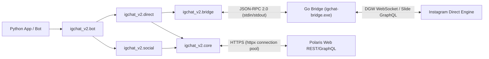

<div align="center">

<a href="https://github.com/0xshijn/igchat-v2">
  
</a>

<br />

<p>
  <a href="https://www.python.org/"></a>
  <a href="https://go.dev/"></a>
  <a href="LICENSE"></a>
  <a href="https://github.com/0xshijn"></a>
  <a href="https://t.me/ShiinNoHacker"></a>
</p>

<p>
  <a href="https://github.com/0xshijn/igchat-v2/stargazers"></a>
  <a href="https://github.com/0xshijn/igchat-v2/network/members"></a>
  <a href="https://github.com/0xshijn/igchat-v2/issues"></a>
  
</p>

[🇻🇳 Tiếng Việt](README.md) · [📖 API Reference](DOCS.md) · [🔀 Flowchart](FLOWCHART.md) · [🧠 Mindmap](mindmap-mermaid.md) · [🌉 Go Bridge](bridge/README.md) · [🐛 Bug Reports](https://github.com/0xshijn/igchat-v2/issues)

</div>

> *"Pwn the protocol, dissect the wire, automate the unscriptable."* — **0xshijn**

> [!WARNING]
> **IGChat-v2** is an unofficial client intended for protocol research and Instagram Direct automation. It authenticates using account session cookies. Never commit configuration files containing credentials (`src/config.json`) or expose your `sessionid` to public environments.

---

## 🎯 Overview

**IGChat-v2 (v3.0.0)** was designed and developed by **Phước Toàn (Shiin / [`0xshijn`](https://github.com/0xshijn))** as a comprehensive, independent, and accurate platform for automating **Instagram Direct** and Instagram social interactions.

Completely distinct from legacy Messenger/Facebook derivatives (`fbchat`), **v3.0.0** completely eradicates all unrelated upstream contamination:
- ❌ Zero legacy Facebook Comet GraphQL mutations.
- ❌ Zero misplaced E2EE layers (`whatsmeow`, `libsignal`, `e2ee_device.json`).
- ❌ Zero Facebook cookie dependencies (`c_user`, `xs`, `datr`).
- ✅ **100% Pure Instagram**: Native Instagram Direct DGW WebSocket, Slide GraphQL, and Polaris Web REST APIs.
- ✅ **Professional Layered Architecture**: Async Python client (`igchat_v2`) paired with a Go bridge companion (`instameow`) communicating over line-delimited JSON-RPC 2.0.

---

## ⚡ Technical Highlights

<table>
  <tr>
    <td width="50%" valign="top">
      <h4>🚀 Async-First Python Client</h4>
      <p>Entire I/O built on top of <code>asyncio</code> and <code>httpx.AsyncClient</code> with pooled HTTP connections, finite timeouts, and structured error hierarchies.</p>
    </td>
    <td width="50%" valign="top">
      <h4>🌉 Real-time Go Bridge (v3.0.0)</h4>
      <p>High-performance Go daemon (<code>build/igchat-bridge.exe</code>) utilizing <code>instameow</code> to drive DGW WebSocket and MQTT bypass connections with generation fencing and auto-recovery.</p>
    </td>
  </tr>
  <tr>
    <td width="50%" valign="top">
      <h4>🛡️ Hardened Security &amp; SSRF Guard</h4>
      <p>Strict URL destination validation blocks SSRF attacks to internal networks / cloud metadata when downloading media; automatic secret redaction in stderr logs; atomic permission enforcement (<code>0600</code> / Windows ACL).</p>
    </td>
    <td width="50%" valign="top">
      <h4>🤖 Turnkey Bot Framework</h4>
      <p>Production-ready <code>InstagramBot</code> engine equipped with bounded LRU message deduplication, per-user rate limiting, async command router, and secure admin access controls.</p>
    </td>
  </tr>
</table>

---

## 🏗️ System Architecture



| Package / Module | Path | Description |
|---|---|---|
| **`igchat_v2.core`** | [`src/igchat_v2/core/`](src/igchat_v2/core/) | Data models (`InstagramSession`, `MessageEvent`), HTTP pooling, SSRF guard, private file permissions, secret redaction |
| **`igchat_v2.auth`** | [`src/igchat_v2/auth/`](src/igchat_v2/auth/) | Session bootstrap from cookies, secure storage, Web AJAX login with 2FA TOTP (`pyotp`) |
| **`igchat_v2.bridge`** | [`src/igchat_v2/bridge/`](src/igchat_v2/bridge/) | Subprocess supervisor for Go Bridge over line JSON-RPC, generation-fencing, ReconnectPolicy with backoff |
| **`igchat_v2.direct`** | [`src/igchat_v2/direct/`](src/igchat_v2/direct/) | Direct listener, send/edit/unsend message, reactions, thread & inbox management, 24h Notes, media rupload |
| **`igchat_v2.social`** | [`src/igchat_v2/social/`](src/igchat_v2/social/) | Profile, bio editor, friendship actions (follow/block), post interactions (like/save/comment), user search |
| **`igchat_v2.bot`** | [`src/igchat_v2/bot/`](src/igchat_v2/bot/) | Comprehensive bot runtime, command router, spam filter, per-user rate limiter, OS signal handler |
| **`bridge/`** | [`bridge/`](bridge/README.md) | Go bridge source code powered by `instameow`, compiling to `build/igchat-bridge.exe` |

---

## 🛠️ Installation & Environment Setup

### Prerequisites

- **Python 3.10+** (Python 3.11, 3.12, or 3.13 recommended)
- **Go 1.23+** (for compiling the Go bridge)
- **Git** (with submodule support for `bridge/meta`)

### 1. Clone repository & install Python package

```bash
git clone --recurse-submodules https://github.com/0xshijn/igchat-v2.git
cd igchat-v2

# Create virtual environment
python -m venv .venv

# Activate virtual environment:
# Windows (PowerShell):
.venv\Scripts\Activate.ps1
# Linux / macOS:
source .venv/bin/activate

# Upgrade pip and install package in editable mode
python -m pip install --upgrade pip
python -m pip install -e .
```

### 2. Compile Go Bridge companion

```bash
cd bridge
go test -v ./...
go build -trimpath -ldflags="-s -w -X main.bridgeVersion=3.0.0" -o ../build/igchat-bridge.exe .
cd ..
```

Verify the compiled binary using the bridge smoke test script:

```bash
python scripts/smoke_bridge_rpc.py build/igchat-bridge.exe --expected-version 3.0.0
```

---

## 🚀 Quickstart Guide

### 1. Basic Direct Messaging

```python
import asyncio
from igchat_v2.auth import bootstrap_session
from igchat_v2.bridge import BridgeProcess, BridgeActions
from igchat_v2.direct import send_text_message


async def main() -> None:
    # 1. Bootstrap session from Instagram cookies
    cookie_str = "sessionid=YOUR_SESSION_ID; ds_user_id=YOUR_USER_ID; csrftoken=YOUR_CSRF_TOKEN;"
    session = await bootstrap_session(cookie_str)
    print(f"Logged in as: @{session.username} ({session.user_id})")

    # 2. Launch Go Bridge process
    process = BridgeProcess()
    await process.start()
    actions = BridgeActions(process)

    # 3. Connect to Instagram Direct
    await actions.connect(session.raw_cookies)

    # 4. Dispatch Direct message
    result = await send_text_message(
        actions,
        thread_id="340282366841710300949128134123456789012",
        text="Hello from igchat-v2 v3.0.0!",
    )
    print(f"Message sent! ID: {result.message_id}")

    # 5. Clean up
    await process.stop()


if __name__ == "__main__":
    asyncio.run(main())
```

### 2. Real-time Message Listener (DirectListener)

```python
import asyncio
from igchat_v2.auth import bootstrap_session
from igchat_v2.direct import DirectListener
from igchat_v2.core.models import MessageEvent


async def handle_message(event: MessageEvent) -> None:
    print(f"[{event.thread_id}] @{event.sender_id}: {event.text}")


async def main() -> None:
    session = await bootstrap_session("sessionid=...; ds_user_id=...; csrftoken=...;")
    listener = DirectListener(session=session)
    listener.on_message(handle_message)

    print("Listening for Instagram Direct events...")
    await listener.start()


if __name__ == "__main__":
    asyncio.run(main())
```

---

## 🤖 Running the Included Bot (`main.py` / `src/main.py`)

A full-featured Instagram bot with utility, group management, and social automation commands is included out of the box.

### 1. Configure Bot

Copy the example configuration:

```bash
cp src/config.example.json src/config.json
```

Edit `src/config.json`:

```json
{
  "botName": "igchat-v2 bot",
  "prefix": "/",
  "cookies": "sessionid=...; ds_user_id=...; csrftoken=...;",
  "admins": ["1000xxxxxxxxxx"],
  "log_message_content": false,
  "debug_errors": false
}
```

### 2. Launch Bot

```bash
python main.py
```

<details>
<summary>📋 <b>Built-in Bot Commands (Click to expand)</b></summary>

<br />

| Category | Command | Description |
|---|---|---|
| **System** | `/ping`, `/help`, `/info`, `/status`, `/uptime` | Check connection health, uptime latency, command list |
| **Messaging** | `/echo`, `/react`, `/edit`, `/unsend`, `/quote` | Echo message, add reaction, edit or recall sent messages |
| **Group Admin** | `/rename`, `/add`, `/kick`, `/mute`, `/theme`, `/title` | Change group title, add/remove members, switch thread theme |
| **Instagram Notes**| `/note`, `/delnote`, `/notes`, `/music` | Publish 24h Notes, search background music, delete active Note |
| **Social** | `/profile`, `/bio`, `/follow`, `/unfollow`, `/block` | View profiles, update bio, follow, unfollow, and block users |
| **Posts & Media** | `/like`, `/save`, `/comment`, `/delcomment` | Like media, bookmark post, post comment, delete comment |

</details>

---

## 🧪 Quality Assurance & Verification

The project adheres to strict production engineering standards:

```bash
# 1. Run complete Python test suite (38/38 passing)
pytest tests/ -v

# 2. Verify code style & formatting
black --check .
ruff check .

# 3. Strict static type analysis
mypy src/igchat_v2 src/main.py scripts tests

# 4. Run Go Bridge test suite
cd bridge && go test -v ./... && go vet ./... && cd ..
```

---

## 📜 License & Author

Distributed under the [**Apache License 2.0**](LICENSE).  
The Go bridge component uses `instameow` from [mautrix-meta](https://github.com/mautrix/meta) under the GPL-3.0 license.

<div align="center">

Developed and maintained by **[Phước Toàn (Shiin / 0xshijn)](https://github.com/0xshijn)**
<br />
[Portfolio](https://0xshijn.is-a.dev) · [Telegram](https://t.me/ShiinNoHacker) · [Instagram](https://instagram.com/_phwctoazn) · [GitHub](https://github.com/0xshijn)

</div>
