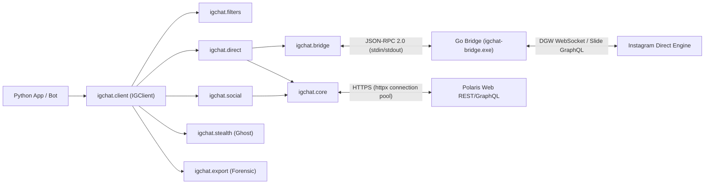

<div align="center">

<a href="https://github.com/0xshijn/igchat-v2">
  
</a>

<br />

<p>
  <a href="https://pypi.org/project/igchat-v2/"></a>
  <a href="https://pypi.org/project/igchat-v2/"></a>
  <a href="https://www.python.org/"></a>
  <a href="https://go.dev/"></a>
  <a href="LICENSE"></a>
</p>

<p>
  <a href="https://github.com/0xshijn/igchat-v2/stargazers"></a>
  <a href="https://github.com/0xshijn/igchat-v2/network/members"></a>
  <a href="https://github.com/0xshijn/igchat-v2/issues"></a>
  <a href="https://github.com/0xshijn/igchat-v2/actions/workflows/ci.yml"></a>
  
</p>

```bash
pip install igchat-v2
```

[🇻🇳 Tiếng Việt](README.md) · [📦 PyPI Package](https://pypi.org/project/igchat-v2/) · [💡 Examples](examples/) · [🛡️ Security](SECURITY.md) · [🤝 Contributing](CONTRIBUTING.md) · [🌉 Go Bridge](bridge/README.md) · [🐛 Bug Reports](https://github.com/0xshijn/igchat-v2/issues)

</div>

> *"Pwn the protocol, dissect the wire, automate the unscriptable."* — **0xshijn**

> [!WARNING]
> **IGChat-v2** is an unofficial client intended for protocol research and Instagram Direct automation. It authenticates using account session cookies. Never commit configuration files containing credentials (`config.json`) or expose your `sessionid` to public environments.

---

## 🎯 Overview

**IGChat-v2 (v3.1.0)** was designed and developed by **Phước Toàn (Shiin / [`0xshijn`](https://github.com/0xshijn))** as a comprehensive, independent, and accurate platform for automating **Instagram Direct** and Instagram social interactions.

**v3.1.0** delivers a modern, optimized, and native platform engineered specifically for Instagram:
- ✅ **One-Line Installation**: Officially released on PyPI (`pip install igchat-v2`).
- ✅ **100% Pure Instagram Protocol**: Native Instagram Direct DGW WebSocket, Slide GraphQL, and Polaris Web REST APIs.
- ✅ **🥷 Zero-Presence Ghost Mode**: Read all messages without the sender **ever receiving a "Seen" read receipt**.
- ✅ **🕵️ Headless Anti-Unsend & Forensic Archiver**: Automatically captures and stores messages/photos/voice clips before the sender revokes them, exporting to standalone Dark Mode HTML.
- ✅ **Professional Layered Architecture**: Async Python client (`igchat`) paired with a Go bridge companion (`instameow`) communicating over line-delimited JSON-RPC 2.0.

---

## ⚡ Technical Highlights

<table>
  <tr>
    <td width="50%" valign="top">
      <h4>🚀 Async-First Python Client</h4>
      <p>Entire I/O built on top of <code>asyncio</code> and <code>httpx.AsyncClient</code> with pooled HTTP connections, finite timeouts, and structured error hierarchies.</p>
    </td>
    <td width="50%" valign="top">
      <h4>🌉 Real-time Go Bridge (v3.1.0)</h4>
      <p>High-performance Go daemon (<code>build/igchat-bridge.exe</code>) utilizing <code>instameow</code> to drive DGW WebSocket and MQTT bypass connections with generation fencing and auto-recovery.</p>
    </td>
  </tr>
  <tr>
    <td width="50%" valign="top">
      <h4>🥷 Ghost Mode &amp; Humanizer</h4>
      <p>Zero-footprint stealth: completely suppresses read receipts (no "Seen" state), hides online presence via <code>X-IG-Presence: 0</code>, and simulates natural Gaussian typing cadence.</p>
    </td>
    <td width="50%" valign="top">
      <h4>🕵️ Anti-Unsend &amp; Forensic Vault</h4>
      <p>Real-time memory buffer catches messages before deletion. Supports raw CDN extraction for "View Once" media and exports offline chats to standalone Dark Mode HTML or JSON.</p>
    </td>
  </tr>
  <tr>
    <td width="50%" valign="top">
      <h4>🛡️ Hardened Security &amp; SSRF Guard</h4>
      <p>Strict URL destination validation blocks SSRF attacks to internal networks / cloud metadata when downloading media; automatic secret redaction in stderr logs; atomic permission enforcement (<code>0600</code> / Windows ACL).</p>
    </td>
    <td width="50%" valign="top">
      <h4>🤖 Turnkey Bot Framework &amp; Filters</h4>
      <p>Composable event routing <code>@client.on(filters.command("...") &amp; filters.private)</code> with logical bitwise operators <code>&amp;</code>, <code>|</code>, <code>~</code>. Built-in LRU deduplication and per-user rate limiting.</p>
    </td>
  </tr>
</table>

---

## 🏗️ System Architecture



| Package / Module | Path | Description |
|---|---|---|
| **`igchat.client`** | [`igchat/client.py`](igchat/client.py) | **High-Level Fluent SDK (`IGClient`)**: Context manager, event decorators `@client.on(...)`, auto pagination |
| **`igchat.filters`** | [`igchat/filters.py`](igchat/filters.py) | **Composable Message Filters**: Bitwise operators `&`, `\|`, `~`, `^` (text, command, regex, media, group, sender...) |
| **`igchat.stealth`** | [`igchat/stealth.py`](igchat/stealth.py) | **Ghost Mode & Humanizer**: Stealth anti-detection, presence suppression (`X-IG-Presence: 0`), Gaussian typing pacing |
| **`igchat.export`** | [`igchat/export.py`](igchat/export.py) | **Forensic Chat Archiver**: Export threads to JSON, Markdown, or aesthetic Dark Mode HTML matching Instagram Web |
| **`igchat.core`** | [`igchat/core/`](igchat/core/) | Data models (`InstagramSession`, `MessageEvent`), HTTP pooling, SSRF guard, private file permissions, secret redaction |
| **`igchat.auth`** | [`igchat/auth/`](igchat/auth/) | Session bootstrap, **Encrypted Session Vault (PBKDF2 + authenticated stream cipher)**, Web AJAX login with 2FA TOTP |
| **`igchat.bridge`** | [`igchat/bridge/`](igchat/bridge/) | Subprocess supervisor for Go Bridge over line JSON-RPC, generation-fencing, ReconnectPolicy with backoff |
| **`igchat.direct`** | [`igchat/direct/`](igchat/direct/) | Direct listener, send/edit/unsend message, reactions, **Themes & Direct Polls**, **Voice waveform (64 peaks)** |
| **`igchat.social`** | [`igchat/social/`](igchat/social/) | Profile, bio editor, friendship actions, **Unfollowers & Close Friends Analytics (`analytics.py`)**, post interactions |
| **`igchat.bot`** | [`igchat/bot/`](igchat/bot/) | Comprehensive bot runtime, command router, spam filter, per-user rate limiter, OS signal handler |

---

## 🛠️ Installation & Getting Started

### Option 1: Install from PyPI (Recommended)

```bash
pip install igchat-v2
```

### Option 2: Install from Source (For Development)

```bash
git clone https://github.com/0xshijn/igchat-v2.git
cd igchat-v2

# Create virtual environment
python -m venv .venv
.venv\Scripts\Activate.ps1 # Or: source .venv/bin/activate

# Install in editable mode
pip install -e ".[dev]"

# Run test suite
pytest tests/
```

---

## 🚀 Quickstart Guide

### 1. Fluent SDK & Real-time Ghost Mode Listener

```python
import asyncio
from igchat import IGClient, filters


async def main() -> None:
    # Initialize client with Ghost Mode enabled (read messages WITHOUT triggering "Seen")
    async with await IGClient.from_cookie("sessionid=...; ds_user_id=...; csrftoken=...;", stealth=True) as client:

        # Listen for /ping commands in direct messages
        @client.on(filters.command("ping") & filters.private)
        async def on_ping(event: dict) -> None:
            thread_id = event["data"]["threadId"]
            await client.send_message(thread_id, "pong! 🥷 (Read stealthily via Ghost Mode)")

        print("Bot running in Ghost Mode...")
        await client.run_forever()


if __name__ == "__main__":
    asyncio.run(main())
```

### 2. Basic Direct Messaging

```python
import asyncio
from igchat.auth import bootstrap_session
from igchat.direct import send_text_message


async def main() -> None:
    session = await bootstrap_session("sessionid=...; ds_user_id=...; csrftoken=...;")
    
    # Send message via standard Polaris GraphQL
    result = await send_text_message(
        session,
        thread_id="17845618319961946",
        text="Hello from igchat-v2 v3.1.0!",
    )
    print("Status:", result.get("status"))


if __name__ == "__main__":
    asyncio.run(main())
```

### 3. Forensic Chat Export to Dark Mode HTML

```python
import asyncio
from igchat.auth import bootstrap_session
from igchat.export import export_thread_to_html


async def main() -> None:
    session = await bootstrap_session("sessionid=...; ds_user_id=...; csrftoken=...;")
    
    # Download and export full conversation history to a self-contained HTML file
    html_file = await export_thread_to_html(
        session,
        thread_id="17845618319961946",
        output_path="chat_export.html",
    )
    print(f"Chat export report generated: {html_file}")


if __name__ == "__main__":
    asyncio.run(main())
```

---

## 🧪 Test Suite & Verification

The project includes **50/50 comprehensive unit tests** with a 100% pass rate:

```bash
pytest tests/
# ============================= 50 passed in 1.98s =============================
```

---

## 🤝 Contributing

Contributions, bug reports, and suggestions are welcome! Please review [`CONTRIBUTING.md`](CONTRIBUTING.md) and adhere to [`CODE_OF_CONDUCT.md`](CODE_OF_CONDUCT.md).

---

## 📜 License & Copyright

Developed by **[Phước Toàn (Shiin / 0xshijn)](https://github.com/0xshijn)**.  
Distributed under the **[Apache-2.0 License](LICENSE)**.
