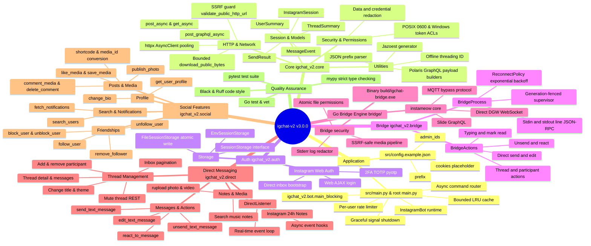

# igchat-v2 - Mindmap kiến trúc v3.0.0

[README](README.md) | [README (EN)](README_EN.md) | [Tài liệu API](DOCS.md) | [Flowchart](FLOWCHART.md) | [Bridge Docs](bridge/README.md)

Mindmap thể hiện tổng quan phân lớp kiến trúc dự án `igchat-v2` v3.0.0. Xem [FLOWCHART.md](FLOWCHART.md) để theo dõi chi tiết luồng xử lý và [DOCS.md](DOCS.md) để tra cứu chữ ký API.
